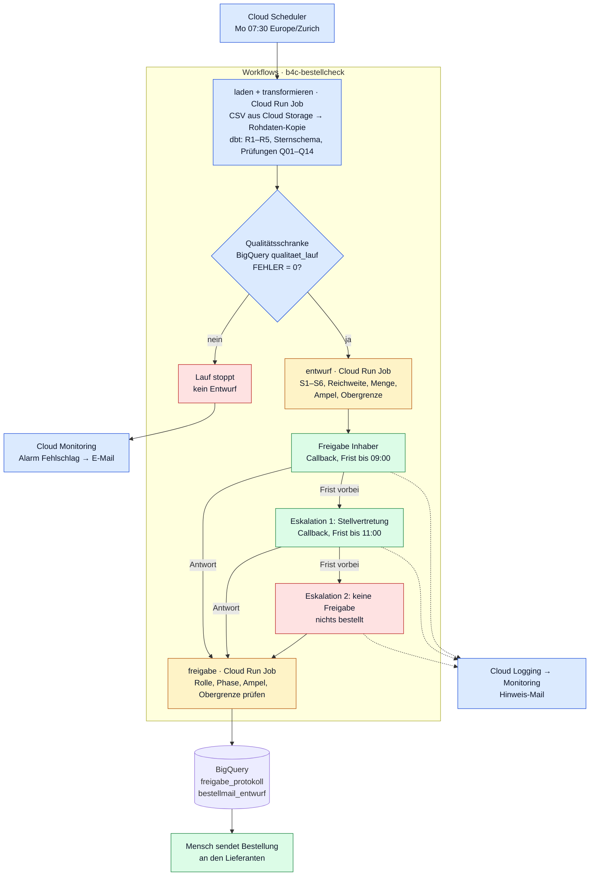

# 02 · Workflow-Konzept «Bestell-Check mit Freigabe»

> **Leitfrage:** «Wie viel soll ich pro Snack bestellen, und gibt es ein Warnsignal?»
> Typ: **Workflow mit menschlicher Freigabe** (kein Agent: das System wählt keine Werkzeuge selbst, jeder Schritt ist fest).
> Daten im Prototyp: **synthetisch**. Projekt `b4c-bestellcheck-hs26`, Region `europe-west6`.

## 1 Ablauf

Blau: automatisiert · Gelb: vorbereitet · Grün: Mensch entscheidet oder handelt · Rot: Stopp oder Eskalation

## 2 Eingaben (IR-01 bis IR-07)

| IR | Inhalt | Quelle (synthetisch) | Tabelle | Ausfallverhalten im Prototyp (laut Katalog) |
|---|---|---|---|---|
| IR-01 | Vorwarnung: angekündigt am, Beginn, Dauer, Menge %, Kanal | `vorwarnungen.csv` | `fakt_vorwarnung` | Kein Eintrag heisst **«keine Vorwarnung bekannt»**, nicht «keine Störung» (so steht es im Text) |
| IR-02 | Reichweite = (Bestand + unterwegs) ÷ Absatz | berechnet | `bestellentwurf.reichweite_wochen` | Bestand fehlt → Vorwochenwert, «geschätzt», Ampel gelb |
| IR-03 | Bestellbedarf = Soll − Bestand − unterwegs | `bestand_montag.csv` | `fakt_bestand` → `menge_vorschlag` | Keine Zählung → Bestand der Vorwoche, «geschätzt» (Prüfung Q09 WARNUNG) |
| IR-04 | Offene Bestellungen, zugesagter Liefertag | `lieferungen.csv` | `fakt_lieferung` | Status unklar → S3: nachfragen, nicht neu bestellen (gelb) |
| IR-05 | Ausverkauf vor 15 Uhr, verpasste Nachfrage | `strichliste.csv` | `fakt_strichliste`, `dim_datum` | Tag nicht geführt → **«fehlt», nicht 0** (Q08) |
| IR-06 | Lieferungen zu spät oder unvollständig (letzte 8) | `lieferungen.csv` | `fakt_lieferung` | Lieferdatum fehlt → «unbekannt», nicht «pünktlich» |
| IR-07 | Verderb pro Woche | `verderb.csv` | `fakt_verderb` | Woche fehlt → «fehlt», S5 wird nicht ausgelöst |
| – | Plan-Absatz pro Produkt (80/70/70/60) | Modell v5 (Annahme) | `dim_produkt` | fest; bei Änderung «gültig ab» (SCD 2), hier weggelassen |

## 3 Regeln (alle in `prototyp/job/regeln.py`, Schwellen sind Annahmen)

| Regel | Bedingung | Schwelle | Wirkung im Entwurf | Ladder |
|---|---|---|---|---|
| **Reichweite (Q-01)** | (Bestand + unterwegs) ÷ Plan-Absatz, verglichen mit dem Ziel | Ziel 1.5 Wo. bei Vorwarnung | Text «reicht / reicht NICHT bis Störungsende» | 4 (Hinweis) |
| **S6 Vorwarnung** | bekannt am Stichtag, Störung noch nicht vorbei | – | Reserve 0.75 → 1.5 Wo., Soll × 2, **gelb** | 3 |
| **Entscheidregel** | ≥ 2 von 3 Vorwarnungen mit ≥ 7 Tagen Vorlauf | 3 Fälle, 2/3, 7 Tage | «zu wenig Fälle» → S6 vorbereiten; «nicht erfüllt» → S6 gesperrt, S4 gilt | steuert S6 |
| **Zu späte Vorwarnung** | S6 aktiv und Vorlauf < 7 Tage | 7 Tage | **rot**, nur Inhaber | 3 |
| **S2 Bestellmenge (Q-02)** | Soll − Bestand − unterwegs > 0 | Soll = Plan-Absatz × Reserve, aufgerundet | `menge_vorschlag` | 3 |
| **Obergrenze** | Menge > 1 Wochen-Plan-Absatz | 80/70/70/60 | **rot**; Freigabe darüber nur Inhaber mit Begründung | 3 |
| **Rückfallmenge** | Menge bei normaler Reserve, ≤ Obergrenze | 0.75 Wo. | Wenn die Stellvertretung eine rote Zeile freigibt, gilt diese Menge | 3 |
| S3 Ware unterwegs | zugesagt + 2 Tage < Stichtag, nicht geliefert | 2 Tage | **gelb**, «zuerst nachfragen» | 2 |
| S4 Lieferant | ≥ 2 von 8 fälligen Lieferungen zu spät oder < 90 %, ohne Vorwarnung | 2 von 8, 90 % | Hinweis «Reserve leicht erhöhen (Höhe offen)» | 2 |
| S1 Ausverkauf | ≥ 2 der letzten 4 Wochen vor 15 Uhr leer | 2 von 4, 15:00 | Hinweis «Soll prüfen (Q-03)» | 2 |
| S5 Verderb | letzte abgeschlossene Woche > 3 % | 3 % | Hinweis «Reserve senken», während S6 nicht anwenden | 2 |

**Ampel pro Produkt:** grün, wenn nichts davon zutrifft. Gelb bei S6, geschätztem Bestand oder S3. Rot bei zu später Vorwarnung oder wenn die Menge über der Obergrenze liegt.

**Korrekturen gegenüber dem MVP** (getestet in `test_regeln.py`):
- S1, S4 und S5 zählen nur Daten **vor dem Stichtag**. Das MVP nahm Lieferungen vom 20. und 22.11. und den Verderb der laufenden Woche mit.
- S4 nimmt angekündigte Störungen aus (Katalog B1) und rechnet «unvollständig» mit < 90 % statt < 100 %. Ergebnis am 16.11.: **0 von 5, ruhig** (MVP: ausgelöst).
- S5 am 16.11.: Chips 1.4 %, ruhig (MVP: 4 %, aus der Woche, die erst beginnt).
- Die Entscheidregel ist neu im Code. Das MVP wendete S6 ohne sie an.
- Die Reichweite (IR-02) ist neu, denn Q-01 war im MVP nicht beantwortet.
- Das Soll wird gerechnet (Plan-Absatz × Reserve), nicht aus der Erfassung übernommen.

## 4 Werkzeuge: welcher Google-Cloud-Dienst welchen Schritt trägt

| Dienst | Ressource | Trägt | Stufe |
|---|---|---|---|
| Cloud Storage | `gs://b4c-bestellcheck-hs26-daten/daten/*.csv` | Landezone der 5 Erfassungslisten (heute: synthetische CSV) | – |
| Cloud Run Jobs | `b4c-wochenlauf` (Modi `laden`, `transformieren`, `entwurf`, `freigabe`) | Rohdaten-Kopie, Bereinigung R1–R5 und Prüfungen mit dbt (seit SW11), Regeln und Freigabeprüfung (Python, `regeln.py`) | 4 / 3 |
| BigQuery | Dataset `b4c_bestellcheck` (europe-west6) | Rohdaten pro Lauf (`roh_*`), Stufe 1 (`stg_*`), Sternschema, Prüfungen, Entwurf, Protokoll | – |
| Workflows | `b4c-bestellcheck` | Reihenfolge, Qualitätsschranke, Freigabe per Callback, Fristen, Eskalation | 4 → 3 |
| Cloud Scheduler | `b4c-montag` | Start Montag 07:30 · **seit SW11 angelegt**, startet als `b4c-workflow-sa` | 4 |
| Cloud Logging + Monitoring | 1 Alarmrichtlinie, 1 E-Mail-Kanal | **Fehlschlag-Alarm seit SW11 angelegt.** Hinweis «Freigabe nötig» oder Eskalation: beschrieben, nicht angelegt (`alarm-hinweis.yaml`); im Prototyp stehen die Hinweise im Log (`b4c_ereignis`), die Anfrage zeigt `freigeben.py --zeigen` | 4 |
| IAM | `b4c-job-sa`, `b4c-workflow-sa` (kein eigenes Konto für den Scheduler) | Least Privilege; wer freigeben darf (Rolle Workflows Invoker) | – |
| Cloud Build, Artifact Registry | Repo `cloud-run-source-deploy` | Container für den Job bauen | – |
| Lokal | `freigeben.py` (gcloud, bq) | Mensch sieht den Entwurf und gibt frei | Mensch |

**Datenmodell in BigQuery** (aus SW09 übernommen): Sternschema mit mehreren Faktentabellen, die sich die Dimensionen teilen (Faktenkonstellation). Dimensionen `dim_produkt`, `dim_datum`; Fakten `fakt_strichliste` (Tag × Produkt), `fakt_bestand` (Montag × Produkt), `fakt_lieferung` (Lieferschein × Produkt), `fakt_verderb` (Woche × Produkt), `fakt_vorwarnung` (Ereignis). Je Körnung eine Faktentabelle, damit nichts vor dem Rechnen zusammengezählt wird. Darunter `staging_*` (1:1 aus den CSV), darüber die Lauf-Tabellen aus Abschnitt 5.

## 5 Ausgaben

| Ausgabe | Inhalt | Für wen |
|---|---|---|
| `bestellentwurf` | pro Lauf und Produkt: Menge, Rückfallmenge, Obergrenze, Reichweite, S1–S6, Entscheidregel, **Ampel**, Grund, wer freigeben darf, Begründung, `herkunft = synthetisch` | Inhaber, Stellvertretung |
| `freigabe_protokoll` | **wer** (Rolle, Konto), **wann** (Zeitpunkt), **was** (Vorschlag, freigegebene Menge, Status, Kommentar), Phase | Nachweis, Auswertung «durchklicken» |
| `bestellmail_entwurf` | Text der Bestellung, `versendet = false` | Mensch, der bestellt |
| `qualitaet_lauf`, `meta_bereinigung` | Prüfungen Q01–Q14 pro Lauf, Bereinigungsregeln mit betroffenen Zeilen (bis SW10: `meta_lineage`) | Team, Fehlersuche |
| E-Mails | Fehlschlag: **seit SW11 angelegt**. «Freigabe nötig» und Eskalation: nicht angelegt, dieselben Ereignisse stehen als `b4c_ereignis` in Cloud Logging | Inhaber |

## 6 Freigaben

| Ampel | Phase Inhaber (bis 09:00) | Phase Stellvertretung (bis 11:00) | Keine Antwort |
|---|---|---|---|
| grün | Inhaber, Sammelfreigabe | Inhaber oder Stellvertretung, Sammelfreigabe | nichts bestellt |
| gelb | Inhaber, **einzeln mit Zahl** | Inhaber oder Stellvertretung, einzeln mit Zahl | nichts bestellt |
| rot | Inhaber, einzeln; über der Obergrenze nur mit Begründung | Stellvertretung: nur **Rückfallmenge** (normale Reserve) | nichts bestellt |

«Einzeln mit Zahl» heisst: Wer freigibt, muss die Menge selbst hinschreiben (`--menge Chips=38`), auch wenn sie dem Vorschlag entspricht. Ein blosses «freigeben» gibt nur grüne Zeilen frei.

## 7 Eskalationen

| Auslöser | Wer wird informiert | Was passiert |
|---|---|---|
| Qualitätsschranke zu (FEHLER) | Inhaber (Alarm Fehlschlag) | Kein Entwurf. Rückfall: zählen, Bestellblatt von Hand |
| Job oder Workflow scheitert | Inhaber (Alarm Fehlschlag) | wie oben |
| Inhaber antwortet nicht bis zur Frist | Stellvertretung (`ESKALATION_STELLVERTRETUNG`) | Die Stellvertretung darf grün und gelb freigeben, rot nur in der Rückfallmenge |
| Niemand antwortet | Inhaber (`ESKALATION_KEINE_FREIGABE`) | **Es wird nichts bestellt**, das wird protokolliert. Inhaber anrufen |
| Vorwarnung zu spät, Menge über der Obergrenze | Inhaber (Ampel rot) | nur der Inhaber gibt frei |
| Daten fehlen (Bestand geschätzt, Strichliste fehlt) | in der Ampel (gelb) bzw. als Hinweis | Freigabe einzeln; nach dem Zählen neu laufen lassen |

## 8 Sprachmodell: bewusst nicht gebaut

Denkbar wäre: Vorwarnungs-Mails mit `gemini-3.8-flash` über die BigQuery-Verbindung `vertex-ai` (EU-Multiregion) zu Feldern lesen (angekündigt am, Beginn, Dauer, Menge %). Es gilt: **Das Modell liest, die Regel entscheidet.** Die gelesenen Felder liefen durch dieselbe Entscheidregel und die Freigabe.
Nicht gebaut, weil es nur 2 Vorwarnungen gibt, keine Mailtexte vorliegen und das Erfassen 10 Minuten pro Woche dauert (Brief). Das Modell würde die Leitfrage heute nicht besser beantworten. Es kommt erst in Frage, wenn echte Mails zur Verfügung stehen.

## 9 Rückverfolgung Konzept ↔ Prototyp

| Konzept | Prototyp |
|---|---|
| Reichweite, S1–S6, Entscheidregel, Ampel, Obergrenze, Rückfallmenge | `job/regeln.py` → `bestellentwurf()` |
| Freigaberegeln (Abschnitt 6) | `job/regeln.py` → `freigabe_pruefen()` |
| Ausfallverhalten IR-01–IR-07 | `job/transform/models/` (R1–R5 in SQL, seit SW11; lokal weiter `job/bereinigen.py`), `regeln.py` (Texte, Ampel) |
| Qualitätsschranke | `job/transform/tests/` (Q01–Q14) → `job/qualitaet.py` → `workflow.yaml` Schritte `transformieren`, `schranke` |
| Zeitplan, Rohdaten pro Lauf (SW11) | Cloud Scheduler `b4c-montag`, `job/main.py` Modus `laden` (`roh_*`) |
| Fristen und Eskalation (Abschnitt 7) | `workflow.yaml` Schritte `freigabe_anfragen`, `eskalation_*` |
| Alarme | `alarm-fehlschlag.yaml`, `alarm-hinweis.yaml` |
| Tests der Regeln | `test_regeln.py` (10 Tests) |
