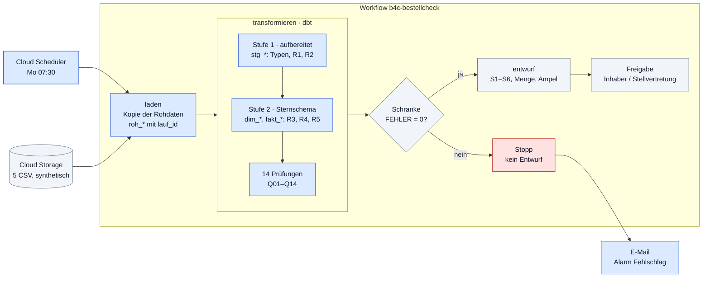

# 04 · Data Engineering: Transformation, Prüfungen, Wiederholbarkeit (SW11)

> **Auftrag SW11:** Den eigenen MVP auf Google Cloud um Aspekte des Data Engineerings ergänzen (GK Woche 10: Transformation, Wiederholbarkeit, automatisierte Prüfungen).
> **Leitfrage bleibt:** «Wie viel soll ich pro Snack bestellen, und gibt es ein Warnsignal?»
> **B4C ist fiktiv, alle Daten sind synthetisch.** Gezeigt wird, dass die Daten sauber, geprüft und wiederholbar aufbereitet werden, nicht dass B4C damit besser bestellt.

## 1 In drei Sätzen

1. **Transformation:** Die Bereinigung der Erfassungslisten (Regeln R1–R5) ist jetzt SQL in zwei Stufen statt ein Python-Skript. Das Werkzeug **dbt** baut die Tabellen in der richtigen Reihenfolge in BigQuery.
2. **Automatisierte Prüfungen:** Nach dem Bauen laufen 14 Prüfungen. Ein FEHLER stoppt den Lauf, bevor ein Bestellentwurf entsteht, und schickt eine E-Mail.
3. **Wiederholbarkeit:** Der Lauf startet jeden Montag um 07:30 von selbst. Jeder Lauf bewahrt seine eigene Kopie der Rohdaten auf, darum lässt sich jedes Ergebnis nachrechnen und belegen.

Kein neues Konto, kein neues Dataset, kein neuer Dienst ausser dem Zeitplan und dem Alarm. dbt läuft im bestehenden Job `b4c-wochenlauf`.

## 2 Vorher und nachher

| Thema | bis SW10 | ab SW11 | Was es bringt |
|---|---|---|---|
| Bereinigung R1–R5 | Python-Skript `bereinigen.py`, alles in einem Schritt | dbt: kurze SQL-Dateien in 2 Stufen, `stg_*` → `dim_*`/`fakt_*` | Jede Stufe ist in BigQuery einzeln anschaubar und prüfbar; jede Regel ist eine lesbare Datei |
| Prüfungen | 11 Prüfungen in einer Abfrage | 14 Prüfungen als dbt-Tests, 3 davon neu aus dem Anforderungskatalog | Prüft nicht nur Technik, sondern auch die Akzeptanzkriterien IR-01 und IR-05 |
| Wenn etwas scheitert | steht nur im Log | E-Mail mit Rückfall-Anweisung | Niemand muss nachschauen, ob es geklappt hat |
| Start | von Hand | jeden Montag 07:30 (Cloud Scheduler) | Läuft auch, wenn niemand daran denkt |
| Rohdaten | bei jedem Lauf überschrieben | Kopie pro Lauf (`roh_*` mit `lauf_id`) | Jeder Entwurf lässt sich auf seine Daten zurückführen |
| Kosten | ohne Grenze | höchstens 1 GB pro Abfrage | Schutz vor einer versehentlich teuren Abfrage |

Blau: neu oder geändert in SW11 · Grau: wie in SW10 · Rot: Stopp

## 3 Transformation mit dbt

**Was dbt ist:** ein Werkzeug, das SQL-Dateien in BigQuery ausführt. Jede Datei erzeugt eine Tabelle. Verweist eine Datei mit `ref('...')` auf eine andere, baut dbt die andere zuerst. Danach führt es die Prüfungen aus. Dasselbe Werkzeug wie im Tutorial (Lektion 2).

**Zwei Stufen statt eines Schritts.** Alle Tabellen liegen im bestehenden Dataset `b4c_bestellcheck`, der Name zeigt die Stufe:

| Stufe | Tabellen | Was passiert | Regel |
|---|---|---|---|
| 0 Rohdaten | `roh_strichliste`, `roh_bestand_montag`, `roh_lieferungen`, `roh_verderb`, `roh_vorwarnungen` | CSV unverändert als Text, eine Kopie pro Lauf. Schreibt der Job im Modus `laden`, nicht dbt | – |
| 1 aufbereitet | `stg_strichliste`, `stg_bestand`, `stg_lieferungen`, `stg_verderb`, `stg_vorwarnungen` | nur die Kopie dieses Laufs; Text → Zahl/Datum; Produktnamen vereinheitlicht; Doppelte zusammengeführt | R1, R2 |
| 2 Sternschema | `dim_produkt`, `dim_datum`, `fakt_strichliste`, `fakt_bestand`, `fakt_lieferung`, `fakt_verderb`, `fakt_vorwarnung` | dieselben Tabellen und Spalten wie in SW10: fehlender Tag = «fehlt», fehlende Zählung = Vorwochenwert «geschätzt», Verspätung und Vollständigkeit | R3, R4, R5 |
| Protokoll | `meta_bereinigung` | wie viele Zeilen jede Regel in diesem Lauf betroffen hat | – |

**Wo die Regeln stehen:**

| Regel (MVP SW09) | Datei in `prototyp/job/transform/models/` |
|---|---|
| R1 Produktname vereinheitlichen | `stufe1_aufbereitet/stg_*.sql` (Abgleich mit der Produktliste `seeds/dim_produkt.csv`) |
| R2 Doppelte zusammenführen | `stufe1_aufbereitet/stg_strichliste.sql` |
| R3 Tag ohne Strichliste = «fehlt», nicht 0 | `stufe2_sternschema/dim_datum.sql` |
| R4 fehlende Zählung = Vorwochenwert, «geschätzt» | `stufe2_sternschema/fakt_bestand.sql` |
| R5 Verspätung und Vollständigkeit | `stufe2_sternschema/fakt_lieferung.sql` |

**Was gleich bleibt:** Die Entscheidungsregeln S1–S6, die Ampel und die Freigabe (`regeln.py`) sind unverändert. Sie lesen dieselben Tabellen wie vorher. dbt bereitet die Daten auf, `regeln.py` entscheidet.

**Begriffe direkt in BigQuery:** Die Definitionen aus dem Anforderungskatalog (B1: Bestand, Ware unterwegs, Ausverkauf, verpasste Nachfrage, Vorwarnung, zu spät/unvollständig, Verderb) stehen als Beschreibung bei den Spalten. In der BigQuery-Konsole: Tabelle anklicken → Schema.

## 4 Automatisierte Prüfungen

**Wie eine Prüfung funktioniert:** Jede Prüfung ist eine kurze SQL-Abfrage, die *falsche* Zeilen sucht (Ordner `transform/tests/`, eine Datei pro Prüfung). Findet sie keine, ist alles in Ordnung. Jede hat eine Schwere:
- **FEHLER**: Mit diesen Daten darf nicht gerechnet werden. Der Lauf stoppt vor dem Entwurf, eine E-Mail geht raus.
- **WARNUNG**: Ein Mangel, den eine Regel schon behandelt. Der Entwurf entsteht, die Ampel und die Begründung zeigen ihn.

Kann dbt eine Tabelle gar nicht bauen (z. B. Text, wo eine Zahl stehen muss), zählt das ebenfalls als FEHLER.

| ID | prüft | Schwere | schützt | seit |
|---|---|---|---|---|
| Q01 | Strichliste: pro Tag und Produkt genau 1 Zeile | FEHLER | S1 zählt nichts doppelt | SW10 |
| Q02 | Bestand: pro Montag und Produkt genau 1 Zeile | FEHLER | eine Bestellmenge pro Produkt | SW10 |
| Q03 | jedes Produkt steht in der Produktliste | FEHLER | jedes Produkt hat einen Plan-Absatz | SW10 |
| Q04 | keine Menge negativ | FEHLER | Bestellmenge nicht künstlich erhöht | SW10 |
| Q05 | Lieferung: bestellt ≤ zugesagt | FEHLER | Verspätung richtig (S3, S4) | SW10 |
| Q06 | Bestand am Stichtag für jedes Produkt da | FEHLER | ohne Zählung keine Bestellmenge (Q-02) | SW10 |
| Q07 | jede Zeile als synthetisch gekennzeichnet | FEHLER | echte und erfundene Daten nie gemischt | SW10 |
| Q08 | Strichliste an jedem Öffnungstag geführt | WARNUNG | «fehlt» statt 0 (R3) | SW10 |
| Q09 | Bestand am Stichtag gezählt, nicht geschätzt | WARNUNG | Ampel gelb, «bitte zählen» (R4) | SW10 |
| Q10 | Vorwarnung ≥ 7 Tage vor Störung | WARNUNG | Entscheidregel des Briefs | SW10 |
| Q11 | Produktnamen in den Rohdaten exakt | WARNUNG | Erfassungsfehler sichtbar (R1) | SW10 |
| **Q12** | Strichliste an ≥ 90 % der Öffnungstage (4 Wochen vor Stichtag) | WARNUNG | S1 nur mit genug Daten · **Akzeptanzkriterium IR-05** | **SW11** |
| **Q13** | Vorwarnung innert 1 Tag notiert | WARNUNG | keine verpasste Bestellung trotz Warnung · **Akzeptanzkriterium IR-01** | **SW11** |
| **Q14** | Bestand ≤ Bestand der Vorwoche + seither geliefert | WARNUNG | Zählfehler oder fehlender Lieferschein fallen auf | **SW11** |

**Wo man das Ergebnis sieht:** Tabelle `qualitaet_lauf` (eine Zeile pro Prüfung und Lauf, Abfrage 6 in `prototyp/abfragen.sql`). Bei einem Stopp nennt der Workflow die Prüfung direkt in seiner Fehlermeldung.

**Alarm:** Scheitert der Job oder der Workflow, geht eine E-Mail mit der Rückfall-Anweisung raus («Bestand zählen, nach Bestellblatt von Hand bestellen»). Grundlage: `prototyp/alarm-fehlschlag.yaml`.

## 5 Wiederholbarkeit

| Was | Wie | Wo sehen |
|---|---|---|
| Jede Woche von selbst | Cloud Scheduler `b4c-montag` startet den Workflow jeden Montag 07:30 (Europe/Zurich). Kein eigenes Konto: Er nutzt das bestehende `b4c-workflow-sa` | Console → Cloud Scheduler |
| Jeder Lauf belegbar | `laden` hängt die 5 CSV als Kopie mit `lauf_id` an `roh_*` an, nichts wird überschrieben. dbt liest nur die Kopie des eigenen Laufs | Abfrage 7 |
| Gleiche Daten → gleiches Ergebnis | dbt ersetzt die Tabellen bei jedem Lauf ganz; die Regeln sind fest. Zwei Läufe mit demselben Stichtag ergeben denselben Entwurf | Abfrage 8 |
| Alles als Code | dbt-Projekt, Job, Workflow und Alarm liegen als Dateien im Repo; Aufbau und Aufräumen stehen in `prototyp/ANLEITUNG.md` | Repo |

Mit synthetischen Daten ist der Stichtag des Zeitplans fest der 16.11.2026 (letzter Montag der Daten). Im Betrieb wäre es der heutige Montag.

## 6 Nachweis (23.11.2026)

Alle Läufe in Console → Workflows → b4c-bestellcheck → Ausführungen.

| Lauf | Zeit | Was | Ergebnis |
|---|---|---|---|
| `58159986…` | 10:44 | erster Testlauf, Stichtag 9.11. | **Schranke zu:** «FEHLER in: meta_bereinigung». Ursache: Unsere Kostenbremse von 100 MB pro Abfrage war zu eng, BigQuery rechnet pro gelesener Tabelle mindestens 10 MB ab (10 Tabellen = 100 MiB). Kein Entwurf entstanden. Grenze auf 1 GB gesetzt, Job neu gebaut |
| `8b475b8b…` | 10:58 | Stichtag 9.11. | **Erfolgreich.** Q01–Q07 OK, Q08/Q10/Q11 WARNUNG (dieselben 3 wie in SW10), Q12–Q14 OK. Entwurf 30/40/33/42, alle gelb (S6) |
| `7da3cd66…` | 11:03 | derselbe Lauf nochmals | **Erfolgreich**, identisches Ergebnis |
| `27260af6…` | 11:12 | absichtlich Stichtag 23.11. (keine Zählung) | **Schranke zu:** «FEHLER in: Q06». Kein Entwurf, Alarm-Mail ausgelöst |
| `abb87b2c…` | 11:14 | vom Cloud Scheduler gestartet (einmal von Hand ausgelöst, um den Weg zu testen) | Stichtag 16.11. ohne Eingabe, wartet auf die Freigabe wie ein normaler Montagslauf |

**Gleiche Zahlen wie vor dem Umbau:**
- **Sternschema:** Alle 7 Tabellen aus dbt sind Zeile für Zeile und Spalte für Spalte identisch mit der Python-Fassung aus SW10 (186 Zeilen).
- **Entwurf (Abfrage 8):** 4 Läufe mit Stichtag 9.11. (2 aus SW10 mit Python, 2 aus SW11 mit dbt) ergeben pro Produkt genau ein Ergebnis: gleiche Menge, gleiche Ampel, wörtlich gleiche Begründung.
- **Bereinigungsprotokoll (Abfrage 9):** dieselben Zahlen wie das Lineage-Protokoll des MVP: 93/16/32/16/2 Rohzeilen, R1, R2, R3 und R4 je 1 Zeile, R5 32 Zeilen.

**Rohdaten pro Lauf (Abfrage 7):** Jeder der Läufe oben hat seine eigene Kopie der 5 Listen (159 Zeilen), mit Uhrzeit. Nichts wurde überschrieben.

**Die neuen Prüfungen auf den anderen Stichtagen** (lokal nachgerechnet): Q12 meldet am 2.11. eine WARNUNG (Strichliste an 5 von 6 Tagen = 83 %), ab dem 9.11. nicht mehr (92–96 %). Q13 und Q14 sind an allen Stichtagen ruhig.

## 7 Kosten

- **Pro Lauf:** ein paar Rappen. BigQuery rechnet pro gelesener Tabelle mindestens 10 MB ab; ein Lauf mit rund 30 Abfragen bleibt deutlich unter 1 GB. Die ersten 1 TiB Abfragen pro Monat sind bei BigQuery gratis.
- **Kostenbremse:** keine einzelne dbt-Abfrage über 1 GB (`profiles.yml`).
- **Zeitplan:** 1 Lauf pro Woche. Cloud Scheduler: 3 Jobs pro Rechnungskonto gratis (Stand unserer Recherche).
- **Alarm:** Google verrechnet Alarmrichtlinien pro Bedingung (nach unserem Stand etwa 0.10 USD pro Bedingung und Monat; auf der Preisseite nicht bestätigt). Unsere Richtlinie hat 2 Bedingungen.
- **Bau des Containers:** ein paar Minuten Cloud Build pro Änderung.

## 8 Grenzen und bewusst weggelassen

- **Zwei Fassungen der Bereinigung:** Lokal (ohne Cloud, für die Tests) rechnet noch `bereinigen.py`, in der Cloud dbt. Dass beide dasselbe ergeben, zeigt Abfrage 8. Zwei Schwellen stehen deshalb doppelt: 15:00 Uhr (S1) und 90 % (vollständig), in `regeln.py` und im SQL.
- **Die Rohdaten wachsen** um rund 160 Zeilen pro Lauf. Für ein Semester egal, im Betrieb würde man alte Kopien nach 13 Monaten löschen lassen (6-Monats-Rückblick IR-06 plus Reserve).
- **Nur der Fehlschlag-Alarm ist angelegt.** Die Hinweis-Mail «Freigabe nötig» (`alarm-hinweis.yaml`) bleibt beschrieben; die Hinweise stehen im Log.
- **Bewusst nicht:** Dataplex-Scans (dbt-Tests prüfen dasselbe im selben Schritt), Lineage-Graph von Google (kostet pro Stunde und hält nur 30 Tage; den Nachweis liefert die Rohdaten-Kopie), eigene Konten pro Dienst, Dashboard und Prognosemodell (vom Brief ausgeschlossen).
- **Ausblick, nicht gebaut:** Erfassung per Formular mit Auswahlliste statt CSV würde R1 und R2 an der Quelle verhindern. Echte Verkaufszahlen aus der Kasse würden die Annahme 80/70/70/60 ersetzen.

## 9 So erklärt es jede Rolle

Kurz und in eigenen Worten. Die Fragen sind solche, die in der Kleinklasse kommen können.

### Projektleitung
**In drei Sätzen:** Wir haben den laufenden Prototyp in drei Punkten verbessert: Die Datenaufbereitung ist jetzt nachvollziehbar (dbt), Fehler werden automatisch erkannt und gemeldet (Prüfungen, Alarm), und der Lauf startet jede Woche selbst (Scheduler). Es gibt kein neues Konto und keinen neuen Datenspeicher, die Kosten liegen bei Rappen pro Lauf. Gezeigt ist der Ablauf mit synthetischen Daten, nicht ein Nutzen für B4C.

| Frage | Antwort |
|---|---|
| Was hat es gekostet? | Rappen pro Lauf; Kostenbremse 1 GB pro Abfrage (Abschnitt 7). |
| Was ist das grösste Risiko? | Zwei Fassungen der Bereinigung (lokal Python, Cloud SQL). Abgesichert durch den Zahlenvergleich (Abfrage 8). |
| Was ist fertig, was offen? | Fertig: Abschnitte 3–5, Nachweis in Abschnitt 6. Offen: Hinweis-Mail, Ablaufdatum der Rohdaten, echte Daten. |

**Zeigen:** Workflow-Grafik eines Laufs (Console → Workflows → b4c-bestellcheck → Ausführungen), Cloud Scheduler.

### Domänenexpertise (Fachseite B4C)
**In drei Sätzen:** Die Regeln aus dem MVP (R1–R5) sind unverändert, nur jetzt als lesbare SQL-Dateien. Neu prüft das System auch zwei Akzeptanzkriterien aus unserem Anforderungskatalog: Strichliste an 90 % der Tage geführt (IR-05) und Vorwarnung innert 1 Tag notiert (IR-01). Fehlen am Montag Zählungen, entsteht kein Entwurf, sondern eine Mail mit dem Rückfall «Bestellblatt von Hand».

| Frage | Antwort |
|---|---|
| Was heisst «Bestand» genau? | Gezählte Stück in Regal und Lager am Montag vor der Bestellung; die Definition steht in BigQuery beim Schema von `fakt_bestand`. |
| Warum ist eine fehlende Strichliste keine 0? | Eine 0 würde «kein Ausverkauf» behaupten. «fehlt» heisst: Wir wissen es nicht (R3, Prüfung Q08). |
| Was passiert bei einer falschen Zählung? | Ist der Bestand höher als Vorwoche plus Lieferungen, meldet Q14 eine Warnung. |

**Zeigen:** Abfrage 6 (Prüfungen) und Abfrage 9 (wie viele Zeilen jede Regel geändert hat).

### Data Engineering (wer gebaut hat)
**In drei Sätzen:** Der Job `b4c-wochenlauf` hat einen neuen Modus `transformieren`, der `dbt build` startet: erst Stufe 1 (`stg_*`), dann das Sternschema, danach 14 Tests mit Schwere `error` oder `warn`. Die Ergebnisse landen in `qualitaet_lauf`, die bestehende Schranke im Workflow liest sie und stoppt bei FEHLER. `laden` hängt die Rohdaten pro Lauf an, dbt filtert auf die `lauf_id`.

| Frage | Antwort |
|---|---|
| Warum dbt und nicht weiter Python? | SQL läuft dort, wo die Daten liegen; jede Stufe ist eine Tabelle und einzeln testbar; dasselbe Werkzeug wie im Kurs. |
| Warum kein eigener Job für dbt? | Weniger Teile: gleiches Konto, gleicher Container, ein Modus mehr. |
| Was ist beim ersten Test passiert? | Die Kostenbremse war zu eng (10 MB Minimum pro Tabelle). Die Schranke hat den Lauf gestoppt und den Grund genannt (Abschnitt 6). |

**Zeigen:** `job/transform/` im Repo, Logs des Jobs (dbt schreibt jedes Modell und jeden Test mit OK/WARN/ERROR).

### Analyse / BI
**In drei Sätzen:** Das Sternschema ist unverändert (2 Dimensionen, 5 Faktentabellen), alle Abfragen aus SW10 funktionieren weiter. Neu gibt es pro Lauf eine Kopie der Rohdaten und ein Protokoll der Bereinigung. Die Spalten tragen die Fachbegriffe als Beschreibung.

| Frage | Antwort |
|---|---|
| Wo ist die Antwort auf die Leitfrage? | `bestellentwurf` (Menge, Reichweite, Ampel, Begründung), Abfrage 3. |
| Kann ich einen alten Lauf nachvollziehen? | Ja: `roh_*` mit dessen `lauf_id` (Abfrage 7). |
| Woher weiss ich, ob ich den Zahlen trauen kann? | `qualitaet_lauf` desselben Laufs: 0 FEHLER, Warnungen lesen (Abfrage 6). |

**Zeigen:** BigQuery → `b4c_bestellcheck` → `fakt_bestand` → Schema (Beschreibungen), Abfragen 6–9.

## 10 Begriffe in einem Satz

| Begriff | Bedeutung |
|---|---|
| **dbt** | Werkzeug, das SQL-Dateien in der richtigen Reihenfolge in BigQuery ausführt und danach Prüfungen laufen lässt. |
| **Stufe 1 (`stg_*`)** | Die Rohdaten eines Laufs, aufgeräumt: richtige Datentypen, einheitliche Namen, keine Doppelten. |
| **Sternschema** | Faktentabellen (was gemessen wird, z. B. Bestand) rund um Dimensionen (wer/wann: Produkt, Datum); aus SW09 übernommen. |
| **Prüfung / Test** | SQL-Abfrage, die falsche Zeilen sucht; keine gefunden = bestanden. |
| **FEHLER / WARNUNG** | FEHLER stoppt den Lauf; WARNUNG wird gemeldet, der Lauf geht weiter. |
| **Schranke** | Schritt im Workflow, der nur weitergeht, wenn keine Prüfung FEHLER hat. |
| **Lauf, `lauf_id`** | Eine Ausführung des Workflows; ihre Nummer steht in jeder Tabelle, die sie schreibt. |
| **Rohdaten-Kopie** | Die 5 CSV so, wie sie an diesem Lauf ankamen, unverändert aufbewahrt. |
| **Cloud Scheduler** | Google-Dienst, der etwas zu einer festen Zeit startet (wie ein Wecker). |
| **Alarmrichtlinie** | Regel in Cloud Monitoring: «wenn ein Lauf scheitert, schicke eine E-Mail». |
| **Workflow** | Google-Dienst, der die Schritte in fester Reihenfolge ausführt und auf die Freigabe wartet. |
| **Cloud-Run-Job** | Unser Programm (Python mit dbt) als Container, der auf Abruf läuft und dann endet. |
| **Service-Account** | Konto für ein Programm statt für eine Person; bestimmt, was der Job darf. |

## 11 Wo was liegt

| Teil | Datei |
|---|---|
| dbt-Projekt | `prototyp/job/transform/` (`dbt_project.yml`, `profiles.yml`, `models/`, `tests/`, `seeds/`) |
| Rohdaten-Kopie, dbt-Aufruf, Prüfergebnisse | `prototyp/job/main.py` (Modi `laden`, `transformieren`), `prototyp/job/qualitaet.py` |
| Ablauf mit Schritt `transformieren` | `prototyp/workflow.yaml` |
| Alarm | `prototyp/alarm-fehlschlag.yaml` |
| Abfragen zum Vorzeigen | `prototyp/abfragen.sql`, Nr. 6–9 |
| Aufbau, Zeitplan, Aufräumen | `prototyp/ANLEITUNG.md`, Abschnitte B, D, E |
