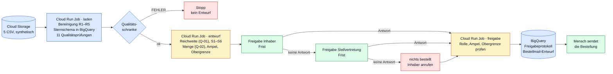

# Präsentation Kleinklasse · Bestell-Check B4C mit Freigabe

> **SW11 (25./26.11.2026): Teil 0** unten, Grundlage [`04-data-engineering.md`](04-data-engineering.md).
> SW10 (Automation): **Teil 1** Kurzfassung, **Teil 2** Folienplan, **Teil 3** Live-Demo, **Teil 4** Zahlen, **Teil 5** Fragen.
> **Alle Daten sind synthetisch, B4C ist fiktiv.** Das gehört sichtbar auf die Titelfolie und in die Fusszeile.

---

## Teil 0 · SW11 Data Engineering (etwa 5–7 Minuten)

### Drei Kernaussagen
1. **Transformation:** Die Bereinigung R1–R5 ist jetzt SQL in zwei Stufen (dbt) statt ein Python-Skript. Jede Stufe ist in BigQuery eine eigene Tabelle, jede Regel eine lesbare Datei.
2. **Automatisierte Prüfungen:** 14 Prüfungen nach jedem Bau, 3 neu aus unserem Anforderungskatalog (IR-01, IR-05, Plausibilität). Ein FEHLER stoppt den Lauf vor dem Entwurf und schickt eine E-Mail.
3. **Wiederholbarkeit:** Jeden Montag 07:30 von selbst; jeder Lauf hat seine eigene Kopie der Rohdaten; gleiche Daten ergeben nachweislich dasselbe Ergebnis wie vor dem Umbau.

### Folienplan

| # | Folie | Inhalt | Quelle | Sagen | Rolle (Vorschlag) |
|---|---|---|---|---|---|
| 1 | **Titel** | «Bestell-Check B4C: vom Prototyp zur verlässlichen Datenpipeline» · Auftrag SW11 · «Daten synthetisch» | – | – | Projektleitung |
| 2 | **Vorher / nachher** | Tabelle mit 6 Zeilen | `04` Abschnitt 2 | «Gleiche Fragen, gleiche Regeln, aber jetzt nachvollziehbar, geprüft und jede Woche von selbst.» | Projektleitung |
| 3 | **Transformation** | Diagramm (Mermaid in `04` Abschnitt 2), Stufen-Tabelle, R1–R5 → Datei | `04` Abschnitt 3 | «dbt bereitet auf, `regeln.py` entscheidet. Das Sternschema ist dasselbe wie vorher, Zeile für Zeile.» | Data Engineering |
| 4 | **Prüfungen** | Q01–Q14, Q12–Q14 hervorgehoben, FEHLER vs. WARNUNG | `04` Abschnitt 4 | «Neu prüfen wir nicht nur Technik, sondern auch unsere eigenen Akzeptanzkriterien aus dem Anforderungskatalog.» | Domänenexpertise |
| 5 | **Schranke und Alarm in Aktion** | Fehllauf Stichtag 23.11. → «FEHLER in: Q06» → E-Mail; erster Testlauf → Schranke stoppt wegen unserer eigenen Kostenbremse | `04` Abschnitt 6 | «Lieber kein Entwurf als ein falscher. Und die Schranke fängt auch unsere eigenen Fehler.» | Data Engineering |
| 6 | **Wiederholbarkeit** | Cloud Scheduler Mo 07:30 · Rohdaten-Kopie pro Lauf · Abfrage 8: 4 Läufe, 1 Ergebnis | `04` Abschnitte 5–6 | «Jeder Entwurf lässt sich auf seine Daten zurückführen und nachrechnen.» | Analyse / BI |
| 7 | **Grenzen und Ausblick** | 2 Fassungen der Bereinigung (lokal / Cloud), Rohdaten wachsen, Hinweis-Mail nur beschrieben · Ausblick: Formular statt CSV, Kassendaten | `04` Abschnitt 8 | «Bewusst klein: kein neues Konto, kein neuer Speicher, Rappen pro Lauf.» | Projektleitung |

### Demo (2 Minuten, alles schon gelaufen, nichts muss live klappen)
Mit Live-Freigabe: Ablauf und Befehle in [`SHOWCASE.md`](SHOWCASE.md), Teil C.

1. **Workflows → b4c-bestellcheck → Ausführungen** → Lauf `8b475b8b…` (erfolgreich): Grafik mit dem neuen Schritt `transformieren`.
2. Fehllauf `27260af6…` (fehlgeschlagen): Fehlermeldung «Qualitätsschranke geschlossen … FEHLER in: Q06».
3. **Cloud Run → Jobs → b4c-wochenlauf** → Ausführung `transformieren` → Logs: dbt baut Tabelle für Tabelle und meldet PASS/WARN.
4. **BigQuery**, Abfrage 6 (Prüfungen) und Abfrage 8 (gleiches Ergebnis über 4 Läufe).
5. **Monitoring → Alerting** (Vorfall) und die erhaltene E-Mail; **Cloud Scheduler** `b4c-montag`.

Fallback: vor der Präsentation Screenshots von 1–5 machen und als Backup-Folien anhängen.

### Erwartbare Fragen (SW11)

| Frage | Antwort |
|---|---|
| Warum dbt statt weiter Python? | Die Bereinigung läuft dort, wo die Daten liegen (BigQuery); jede Stufe ist eine Tabelle und einzeln prüfbar; dasselbe Werkzeug wie im Kurs. |
| Woher wisst ihr, dass dbt dasselbe rechnet wie vorher? | Sternschema Zeile für Zeile verglichen (7 Tabellen, 186 Zeilen, identisch) und Abfrage 8: 4 Läufe mit Stichtag 9.11., pro Produkt 1 Ergebnis. |
| Warum Dataplex nicht, wie im Tutorial? | Für 160 Zeilen prüfen die dbt-Tests dasselbe im selben Schritt, ohne zusätzlichen Dienst und ohne Warten. |
| Was, wenn eine Prüfung zu streng ist? | Darum gibt es zwei Schweren: Nur FEHLER stoppt. Die neuen Prüfungen Q12–Q14 sind WARNUNG. |
| Was kostet das? | Rappen pro Lauf; höchstens 1 GB pro Abfrage (Kostenbremse); Scheduler voraussichtlich gratis. |
| Warum rechnet der Montagslauf mit dem 16.11.? | Die synthetischen Daten enden am 21.11. Im Betrieb wäre der Stichtag der heutige Montag; fehlt dann die Zählung, schliesst Q06 die Schranke, wie im Fehllauf gezeigt. |

---

## Teil 1 · Kurzfassung (5 Kernaussagen)

1. **Leitfrage:** «Wie viel soll ich pro Snack bestellen, und gibt es ein Warnsignal?» Zuerst kommt Q-01 (reicht die Ware bis Störungsende? → Reserve erhöhen, S6), dann Q-02 (wie viel fehlt bis zum Soll? → Bestellmenge).
2. **Entscheidung:** Das System **rechnet und warnt automatisch**, **bereitet** Reserve und Menge **vor** und **bestellt nie selbst**. Jede Menge gibt ein Mensch frei: der Inhaber, sonst nach einer Frist die Stellvertretung. Antwortet niemand, wird nichts bestellt.
3. **Warum nicht mehr Automatisierung:** Die Entscheidregel des Briefs (S6 nur, wenn 2 von 3 Vorwarnungen mindestens 7 Tage vorher kommen) lässt sich mit 2 Vorwarnungen nicht entscheiden. S6 verdoppelt das Soll, und eine falsche oder gefälschte Vorwarnung führt direkt zu Überbestand.
4. **Umsetzung auf Google Cloud, läuft:** Cloud Storage → Cloud-Run-Job → BigQuery (Sternschema) → Workflow mit Qualitätsschranke, Freigabe, Fristen und Eskalation. Beide Fälle sind nachgewiesen: «niemand gibt frei» und «Inhaber gibt frei».
5. **Grenzen:** Die Daten sind synthetisch. Gezeigt wird der Ablauf, nicht der Nutzen. Schwellen, Obergrenze und Bestellformel müssen mit dem Inhaber bestätigt werden.

---

## Teil 2 · Folienplan

| # | Folie | Inhalt (Stichpunkte) | Bild / Quelle | Sagen |
|---|---|---|---|---|
| 1 | **Titel** | «Bestell-Check B4C: automatisch warnen, menschlich bestellen» · Kleinklasse BI · Team · «Daten synthetisch» | – | – |
| 2 | **Leitfrage und Entscheidung** | Leitfrage · Q-01 Rang 1 (Warnsignal, S6) · Q-02 Rang 2 (Menge, S2/S3) · Automation Decision in einem Satz | [`01-automation-decision.md`](01-automation-decision.md) Abschnitt 1 | «Q-01 zuerst: grösste Wirkung (im Modell 145 statt 0 verlorene Verkäufe), und dort kommt das Feedback zu spät.» |
| 3 | **Automation Ladder** | 4 Stufen: Anzeigen · Empfehlen · Vorbereiten · Automatisieren, mit Beispiel pro Stufe (siehe Kasten unten) | [`01`](01-automation-decision.md) Abschnitte 2–3 | «Gerechnet und gewarnt wird automatisch, bestellt wird nie automatisch.» |
| 4 | **Wann höher, wann zurück** | S6: höher erst bei ≥ 3 echten Vorwarnungen, erfüllter Entscheidregel und vom Inhaber bestätigten Schwellen · zurück bei falscher Vorwarnung oder Verderb > 3 % · Ampel grün/gelb/rot | [`01`](01-automation-decision.md) Abschnitt 3, Zeilen 4–6 | «Die Ladder ist nicht fest. Sie hat Bedingungen in beide Richtungen.» |
| 5 | **Pipeline** | Diagramm (unten), Farben: blau automatisch, gelb vorbereitet, grün Mensch, rot Stopp | Mermaid unten → als Bild exportieren | «Jeder Kasten ist ein Google-Cloud-Dienst, jede Farbe eine Stufe der Ladder.» |
| 6 | **Freigaben und Eskalation** | Tabelle Ampel × Phase · Inhaber bis 09:00 → Stellvertretung bis 11:00 → «nichts bestellt, Inhaber anrufen» · gelb und rot nur einzeln mit Zahl | [`02-konzept.md`](02-konzept.md) Abschnitte 6–7 | «Lieber nichts als falsch. Und wer gelb freigibt, muss die Zahl selbst hinschreiben, damit niemand durchklickt.» |
| 7 | **Live-Demo / Nachweis** | Workflow-Grafik von 2 Läufen · Bestellentwurf mit Begründung · Freigabeprotokoll | Teil 3 unten (oder Screenshots) | «Das läuft in Zürich in Google Cloud, nicht nur auf Folien.» |
| 8 | **Risiken und Rückfall** | Top 5 (Kasten unten) mit Gegenmassnahme · Rückfall: S4, Stellvertretung, Bestellblatt von Hand | [`03-risiken.md`](03-risiken.md) | «Das grösste Risiko ist eine falsche Vorwarnung. Deshalb ist S6 nur vorbereitet.» |
| 9 | **Fazit und offen** | Annahme bestätigt (mit 3 Präzisierungen) · offen: Schwellen, Obergrenze, Bestellformel (R13), wer Stellvertretung ist · nächster Schritt: 4 Wochen echte Daten | [`README.md`](README.md) «Mit dem Inhaber zu bestätigen» | «Nächster Schritt ist kein Code, sondern 4 Wochen echte Erfassung und ein Gespräch mit dem Inhaber.» |

Optional als Backup-Folie: **Befunde zur Vorleistung** (MVP SW09). Die Entscheidregel fehlte, Q-01 war nicht berechnet, Signale nutzten Daten nach dem Stichtag (S4 «dauerhaft aktiv» war die Folge). Quelle: [`README.md`](README.md).

### Kasten Folie 3: Automation Ladder

| Stufe | Was das System tut | Bei uns |
|---|---|---|
| 4 Automatisieren | handelt selbst, informiert | Daten laden, prüfen, Signale rechnen, Freigabe anfragen und eskalieren |
| 3 Vorbereiten | fertiger Vorschlag, wartet auf Freigabe | **Reserve erhöhen (S6)**, **Bestellmenge (S2)**, Bestellmail-Entwurf |
| 2 Empfehlen | schlägt vor, Mensch handelt | Nachfragen statt neu bestellen (S3), Reserve leicht erhöhen (S4), Soll prüfen (S1), Verderb (S5) |
| 1 Anzeigen | zeigt nur | Lieferanten informieren |
| – nicht automatisiert | – | **Bestellung senden** (nur Entwurf, `versendet = false`) |

### Kasten Folie 5: Pipeline (Mermaid → Bild über [mermaid.live](https://mermaid.live), «Actions → PNG»)

Untertitel: Gesteuert von **Google Workflows** (`b4c-bestellcheck`) · Region Zürich · Start im Prototyp von Hand. Geplant sind Montag 07:30 per Cloud Scheduler und Alarm-Mails per Cloud Monitoring.

### Kasten Folie 8: Top-5-Risiken

| Risiko | Folge | Gegenmassnahme im Prototyp |
|---|---|---|
| Falsche oder gefälschte Vorwarnung | S6 verdoppelt das Soll → Überbestand, Verderb | S6 nur vorbereitet, gelb, Einzelfreigabe, Obergrenze; Kanal und Vorlauf in der Begründung |
| Vorwarnung zu spät (< 7 Tage) | Reserve kommt nicht rechtzeitig | Ampel rot, nur der Inhaber gibt frei |
| Freigabe aus Gewohnheit («durchklicken») | Fehler gehen ungeprüft durch | Gelb und rot nur einzeln mit selbst geschriebener Zahl (getestet) |
| Unbefugte Freigabe | Bestellung ohne Verantwortung | Senden nur mit Google-Recht, Konto im Protokoll, rot nie durch die Stellvertretung |
| Bestellformel deckt nur die Lücke zur Reserve (R13) | zu wenig bestellt | offen, mit dem Inhaber klären; deshalb bleibt die Menge auf «vorbereiten» |

---

## Teil 3 · Live-Demo (2 Minuten)

**Sicher:** die zwei fertigen Läufe zeigen. **Mutig:** zu Beginn der Präsentation einen neuen Lauf starten ([`NUTZUNG.md`](NUTZUNG.md) B) und bei Folie 7 live freigeben.

1. **Workflows → b4c-bestellcheck → Ausführungen** → Lauf `9acdbe36…` → Grafik. Den Weg zeigen: laden → schranke → entwurf → frage_inhaber → freigabe_verbuchen.
2. Lauf `7a261da2…` → Grafik. Den anderen Weg zeigen: frage_inhaber → Stellvertretung → **eskalation_keine_freigabe**.
3. **BigQuery**, Abfrage 3 aus [`prototyp/abfragen.sql`](prototyp/abfragen.sql): Entwurf mit Menge, Ampel «Freigabe nötig» und Begründung («Reichweite 1.0 Wo. < Ziel 1.5 → reicht NICHT bis Störungsende»).
4. **BigQuery**, Abfrage 4: Lauf 1 viermal «keine Freigabe bis Frist» mit Folge «nichts bestellt, Inhaber anrufen», Lauf 2 viermal «freigegeben», mit Rolle, Konto und Uhrzeit.
5. Optional Abfrage 5: Bestellmail-Entwurf, `versendet = false`.

**Fallback-Screenshots** (falls WLAN oder Login versagt) sind fertig: Backup-Folien 12–14 in `B4C_Woche10_v2.pptx`. Sie zeigen die Liste der Läufe, die Qualitätsschranke, die Workflow-Grafik beider Läufe, das Dataset mit dem Sternschema, Abfrage 1 und Abfrage 4. Aufgenommen am 15.11.2026, Bilddateien in `praesentation/screenshots/`. Abfrage 3 gibt es nur live; den Entwurf zeigt Folie 7.

---

## Teil 4 · Zahlen zum Zitieren (synthetisch, Stichtag 9.11.2026)

| Produkt | Plan-Absatz/Woche | Bestand + unterwegs | Reichweite | Ziel bei Störung | Vorschlag | Ampel |
|---|---|---|---|---|---|---|
| Muesliriegel | 80 | 63 + 27 | 1.1 Wo. | 1.5 Wo. | 30 | gelb |
| Cookies | 70 | 39 + 26 | 0.9 Wo. | 1.5 Wo. | 40 | gelb |
| Chips | 70 | 46 + 26 | 1.0 Wo. | 1.5 Wo. | 33 | gelb |
| Nüsse | 60 | 33 + 15 | 0.8 Wo. | 1.5 Wo. | 42 | gelb |

- **Warnsignal:** Vorwarnung VW-01 kam am 2.11. per Mail, 14 Tage Vorlauf, Störung vom 16. bis 21.11. mit 50 % Liefermenge. Die Reichweite reicht bei keinem Produkt bis Störungsende.
- **Entscheidregel:** «zu wenig Fälle» (1 von 1 rechtzeitig, nötig 2 von 3), darum S6 vorbereiten statt automatisieren.
- **Qualitätsschranke:** 8 Prüfungen OK, 3 Warnungen, 0 Fehler. Die Schranke war also offen.
- **Mengen wie im MVP:** am 16.11. 50 / 23 / 38 / 26. Mit dem MVP vergleichbar, weil dieselbe Formel gilt.
- **Aufwand in Google Cloud:** 1 Bucket, 1 Dataset mit 18 Tabellen, 1 Job, 1 Workflow, 2 Service-Accounts. Kosten: Rappen pro Lauf (nicht gemessen).

---

## Teil 5 · Erwartbare Fragen

| Frage | Antwort |
|---|---|
| Warum kein Agent? | Jeder Schritt ist fest, und das System wählt keine Werkzeuge selbst. Ein Agent bringt hier Risiko ohne Nutzen. Deshalb ist es ein Workflow mit menschlicher Freigabe. |
| Warum kein Sprachmodell? | Es gibt nur 2 Vorwarnungen und keine Mailtexte, und das Erfassen dauert 10 Minuten pro Woche. Als Ausbaustufe beschrieben: «Das Modell liest, die Regel entscheidet.» |
| Warum ein Sternschema mit 5 Faktentabellen? | Jede Quelle hat eine eigene Körnung (Tag, Montag, Lieferschein, Woche, Ereignis). Die Dimensionen Produkt und Datum sind gemeinsam. Das heisst Faktenkonstellation und ist aus SW09 übernommen. |
| Was, wenn der Inhaber nicht antwortet? | Nach der Frist geht die Anfrage an die Stellvertretung. Rote Zeilen darf sie nur in der Rückfallmenge freigeben. Antwortet auch sie nicht, wird nichts bestellt. Das zeigt Lauf 1. |
| Was, wenn die Daten falsch sind? | 11 Prüfungen. Bei FEHLER stoppt die Schranke den Lauf, und es entsteht kein Entwurf. Fehlender Bestand gilt als «geschätzt» und gibt Gelb, ein fehlender Tag als «fehlt», nicht als 0. |
| Bringt das etwas? | Mit synthetischen Daten nicht belegbar. Geprüft wird das in 4 Wochen mit echter Erfassung (H1–H3 aus dem Brief). |
| Wann bestellt das System selbst? | Bei grün frühestens nach 8 Wochen echter Daten, wenn ≥ 90 % der Freigaben unverändert waren und es einen Bestellkanal mit Bestätigung gibt. Bei S6 nie ohne Mensch. |
