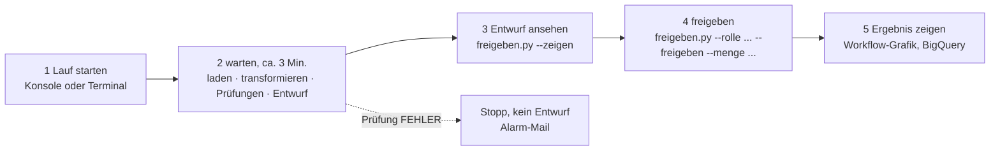

# Showcase: So arbeitet ihr mit dem Bestell-Check

> Schritt für Schritt: einen Lauf starten, den Entwurf ansehen, freigeben, das Ergebnis zeigen. Dazu ein Ablauf für die Präsentation (Teil C).
> Projekt `b4c-bestellcheck-hs26`, Region Zürich. **B4C ist fiktiv, alle Daten sind synthetisch.**
> Hintergrund: [`04-data-engineering.md`](04-data-engineering.md) (was dahinter steckt), [`NUTZUNG.md`](NUTZUNG.md) (alle Links zur Konsole).

## Das Wichtigste in einem Bild



Der Workflow wartet nach Schritt 2 **von selbst** auf eine Antwort. Ihr habt pro Rolle so lange Zeit, wie ihr beim Start als Frist angebt. Antwortet niemand, wird nichts bestellt.

---

## A Vorbereitung (einmal)

| Wer | Was | Womit |
|---|---|---|
| **Jan** (Projekt-Owner, Mac) | nichts, alles ist da | Terminal oder in Claude Code mit `!` vor dem Befehl |
| **Team** (eigenes ZHAW-Konto) | Zugang hat Jan freigegeben (Betrachter, BigQuery-Jobnutzer, Workflows Invoker, siehe [`NUTZUNG.md`](NUTZUNG.md)) | **Cloud Shell**: in der Konsole oben rechts das Symbol `>_`. Ein Terminal im Browser, `gcloud`, `bq` und `python3` sind schon installiert |

**Nur im Team (Cloud Shell), einmal pro Person:**
1. Projekt wählen: `gcloud config set project b4c-bestellcheck-hs26`
2. `freigeben.py` holen: im Cloud-Shell-Menü **⋮ → Hochladen** die Datei `kleinklasse-automation/prototyp/freigeben.py` aus dem Repo hochladen (oder das Repo klonen, wenn Jan es geteilt hat).
3. Test: `python3 freigeben.py --zeigen`. Kommt «Keine offene Freigabe-Anfrage», ist alles richtig eingerichtet, es läuft nur gerade nichts.

**Jan (Mac):** Alle Befehle unten aus dem Ordner `kleinklasse-automation/prototyp` ausführen:
```bash
cd /Users/jansamueltkac/00_WI_Bachelor/B-Int/daeng-hs26-gcp/kleinklasse-automation/prototyp
```

---

## B Ein Lauf in 5 Schritten

### Schritt 1 · Lauf starten

**In der Konsole (ohne Terminal):** [Workflows → b4c-bestellcheck](https://console.cloud.google.com/workflows/workflow/europe-west6/b4c-bestellcheck/executions?project=b4c-bestellcheck-hs26) → oben **Ausführen** → ins Feld «Eingabe»:
```json
{"stichtag": "2026-11-16", "frist_inhaber_s": 1800, "frist_stellvertretung_s": 1800}
```
→ unten **Ausführen**.

**Oder im Terminal:**
```bash
gcloud workflows execute b4c-bestellcheck --location=europe-west6 --project=b4c-bestellcheck-hs26 \
  --data='{"stichtag":"2026-11-16","frist_inhaber_s":1800,"frist_stellvertretung_s":1800}'
```

| Eingabe | Bedeutung |
|---|---|
| `stichtag` | der Montag, für den bestellt wird. Möglich: `2026-10-26`, `2026-11-02`, `2026-11-09`, `2026-11-16` (Tabelle unten) |
| `frist_inhaber_s` | so viele Sekunden darf nur der Inhaber antworten (1800 = 30 Minuten) |
| `frist_stellvertretung_s` | danach so viele Sekunden zusätzlich auch die Stellvertretung |

Für eine Präsentation 1800/1800 wählen: eine Stunde Zeit, und Warten kostet nichts.

### Schritt 2 · Warten, bis der Lauf auf euch wartet (ca. 3 Minuten)

In der Konsole den Lauf anklicken → Reiter **Grafik** (oder «Diagramm»). Der Lauf geht durch `laden` → `transformieren` (dbt und die 14 Prüfungen) → `schranke` → `entwurf` und bleibt dann beim Schritt **`warten`** in `frage_inhaber` stehen. Ab jetzt kann man freigeben.

Bleibt er rot bei `schranke` stehen, hat eine Prüfung FEHLER gemeldet: Es gibt keinen Entwurf und es kommt eine Alarm-Mail (siehe Teil D).

### Schritt 3 · Entwurf ansehen

```bash
python3 freigeben.py --zeigen
```
Beispiel (Stichtag 16.11., gekürzt):
```
Lauf abb87b2c-… · erwartet: Inhaber · Frist bis 2026-11-23 11:46 UTC · DATEN SYNTHETISCH

Chips           38 Stück  [Freigabe nötig]  Obergrenze 70, Rückfall 0 · Inhaber einzeln; nach Frist Stellvertretung
              Q-02: Soll 105 (70/Wo. × 1.5 Wo.) − Bestand 42 − unterwegs 25 = 38 Stück | Q-01: Reichweite 1.0 Wo. < Ziel 1.5 → reicht NICHT …
```
So liest man es:

| Teil | Bedeutung |
|---|---|
| `erwartet: Inhaber` | aktuelle Phase: Wer jetzt freigeben darf. Nach der ersten Frist steht dort `Stellvertretung` |
| `Frist bis … UTC` | bis dann gilt die Phase (UTC + 1 Stunde = Schweizer Zeit) |
| `38 Stück` | Vorschlag des Systems (Q-02) |
| `[Freigabe nötig]` | Ampel **gelb**: nur einzeln mit Zahl. `[automatisch vorbereitet]` = grün, `[Eskalation]` = rot |
| `Obergrenze 70` | darüber nur der Inhaber mit Begründung |
| `Rückfall 0` | Menge bei normaler Reserve; gilt, wenn die Stellvertretung eine rote Zeile freigibt |
| Text darunter | Begründung: Rechnung, Reichweite (Q-01), Vorwarnung, Entscheidregel, Hinweise |

### Schritt 4 · Freigeben (oder ablehnen)

**Regeln in einem Satz:** Grüne Zeilen gibt ein blosses `--freigeben` frei. **Gelbe und rote** Zeilen nur, wenn ihr die Menge selbst hinschreibt (`--menge Produkt=Zahl`), auch wenn sie dem Vorschlag entspricht. So klickt niemand aus Gewohnheit durch.

**Fertige Zeilen zum Kopieren** (Menge = Vorschlag des Systems):

| Stichtag | Ampel | Befehl (als Inhaber) |
|---|---|---|
| `2026-10-26` | alles grün | `python3 freigeben.py --rolle Inhaber --freigeben` |
| `2026-11-02` | alles gelb | `python3 freigeben.py --rolle Inhaber --freigeben --menge Muesliriegel=62 --menge Cookies=55 --menge Chips=56 --menge Nuesse=46` |
| `2026-11-09` | alles gelb | `python3 freigeben.py --rolle Inhaber --freigeben --menge Muesliriegel=30 --menge Cookies=40 --menge Chips=33 --menge Nuesse=42` |
| `2026-11-16` | alles gelb | `python3 freigeben.py --rolle Inhaber --freigeben --menge Muesliriegel=50 --menge Cookies=23 --menge Chips=38 --menge Nuesse=26` |

Ist die erste Frist schon vorbei (`erwartet: Stellvertretung`), geht dieselbe Zeile auch mit `--rolle Stellvertretung`.

**Erwartete Antwort:** `Antwort gesendet (HTTP 200). Der Workflow prüft sie und schreibt freigabe_protokoll.` Nach etwa 1 Minute ist der Lauf in der Konsole **Erfolgreich**.

**Varianten zum Vorzeigen** (jeweils statt der Zeile oben, pro Lauf ist nur **eine** Antwort möglich):

| Was zeigen | Befehl (Stichtag 16.11.) | Im Protokoll steht |
|---|---|---|
| Menge ändern | wie oben, aber `--menge Chips=35` | «geändert freigegeben» |
| Durchklicken wird verhindert | `python3 freigeben.py --rolle Inhaber --freigeben` (ohne Mengen) | 4 × «nicht freigegeben: Einzelbestätigung fehlt» |
| Falsche Rolle | `--rolle Stellvertretung …` während `erwartet: Inhaber` | «nicht befugt: Rolle 'Stellvertretung' in Phase inhaber» |
| Über der Obergrenze | `--menge Chips=90` (Obergrenze 70), ohne Kommentar | «nicht freigegeben: 90 über Obergrenze 70» |
| Ablehnen | `python3 freigeben.py --rolle Inhaber --ablehnen --kommentar "Störung abgesagt"` | 4 × «abgelehnt», Menge 0 |
| Niemand antwortet | nichts tun | nach beiden Fristen: «keine Freigabe bis Frist: nichts bestellt, Inhaber anrufen» |

### Schritt 5 · Ergebnis zeigen

1. **Workflow-Grafik:** Der Lauf ist grün, der Weg führt über `freigabe_verbuchen`.
2. **BigQuery** ([Konsole](https://console.cloud.google.com/bigquery?project=b4c-bestellcheck-hs26)): Abfragen aus [`prototyp/abfragen.sql`](prototyp/abfragen.sql) einfügen und **Ausführen**:
   - **Abfrage 4**: Freigabeprotokoll: wer (Rolle, Konto), wann, welche Menge, Status
   - **Abfrage 5**: Bestellmail-Entwurf mit `versendet = false` (das System bestellt nie selbst)
   - **Abfrage 6**: die 14 Prüfungen dieses Laufs (OK / WARNUNG / FEHLER)

---

## C Ablauf für die Präsentation (Vorschlag)

**Am Tag davor (10 Minuten):**
- [ ] Mit dem Konto, mit dem ihr präsentiert, in der Konsole anmelden, Projekt `b4c-bestellcheck-hs26` wählen.
- [ ] Einmal Schritt 1–5 durchspielen (Stichtag 16.11.). Dann wisst ihr, dass Zugang und `freigeben.py` funktionieren.
- [ ] Screenshots als Backup: Workflow-Grafik (erfolgreich und «Schranke zu»), Log von `transformieren` (dbt mit PASS/WARN), Abfragen 4, 6 und 8, Alarm-Mail, Cloud Scheduler.

**15 Minuten vor der Präsentation:**
- [ ] Schritt 1 mit Stichtag `2026-11-16` und Fristen 1800/1800 starten. Er wartet dann schon, wenn ihr dran seid.
- [ ] Tabs öffnen: Workflows (Ausführungen), BigQuery mit Abfragen 4 und 6, Terminal bzw. Cloud Shell im Ordner mit `freigeben.py`.

**Während der Präsentation (2–3 Minuten Demo):**

| # | Zeigen | Sagen |
|---|---|---|
| 1 | Workflow-Grafik des wartenden Laufs | «Laden, aufbereiten mit dbt, 14 Prüfungen, Entwurf: alles automatisch. Jetzt wartet es auf einen Menschen.» |
| 2 | `python3 freigeben.py --zeigen` | «Vorschlag mit Begründung. Gelb heisst: Der Inhaber muss jede Zahl selbst hinschreiben.» |
| 3 | Freigabe-Zeile für den 16.11. absenden | «Erst jetzt ist etwas entschieden, und das nur als Entwurf, bestellt wird nie automatisch.» |
| 4 | Grafik → grün; Abfrage 4 | «Wer, wann, was: alles protokolliert.» |
| 5 | Abfrage 6 oder den Lauf `27260af6` («FEHLER in: Q06») | «Fehlt die Zählung, gibt es keinen Entwurf, sondern eine Alarm-Mail.» |

**Wenn etwas hängt:** nicht live reparieren, sondern auf die Screenshots wechseln. Die fertigen Läufe vom 23.11. (`8b475b8b…` erfolgreich, `27260af6…` Schranke zu) bleiben in der Konsole sichtbar.

---

## D Die Schranke zeigen (Fehlerfall, optional)

Ein Lauf mit einem Stichtag ohne Zählung, z. B. `{"stichtag": "2026-11-23", "frist_inhaber_s": 60, "frist_stellvertretung_s": 60}`:
- Nach etwa 1 Minute ist der Lauf **Fehlgeschlagen**, Meldung: «Qualitätsschranke geschlossen, Lauf …, FEHLER in: Q06».
- Etwa 5 Minuten später kommen **2 Alarm-Mails** an die hinterlegte Adresse (eine für den Job, eine für den Workflow, beide gehören zum selben Fehler). Das ist gewollt, keine Störung.
- Kein Entwurf, keine Freigabe-Anfrage.

---

## E Wenn etwas nicht klappt

| Meldung | Bedeutung | Was tun |
|---|---|---|
| «Keine offene Freigabe-Anfrage (Frist abgelaufen oder schon beantwortet)» | Es wartet gerade kein Lauf: noch nicht so weit (Schritt 2 abwarten), Frist vorbei oder schon beantwortet | Workflow-Grafik ansehen; sonst neuen Lauf starten (Schritt 1) |
| «nicht befugt: Rolle … in Phase inhaber» im Protokoll | In der ersten Frist darf nur `--rolle Inhaber` | Neuer Lauf, richtige Rolle |
| «nicht freigegeben: Einzelbestätigung fehlt» | Gelbe Zeile ohne `--menge` | Neuer Lauf, Mengen angeben |
| `HTTP Error 403` beim Senden | Dem Konto fehlt die Rolle Workflows Invoker | Jan gibt den Zugang ([`prototyp/ANLEITUNG.md`](prototyp/ANLEITUNG.md), B2) |
| `bq: command not found` oder Login-Fehler | Nicht in Cloud Shell bzw. abgemeldet | Cloud Shell nutzen; am Mac `gcloud auth login` |
| Lauf rot bei `schranke` | Eine Prüfung hat FEHLER | Meldung lesen (welche Prüfung), Abfrage 6; mit dem Stichtag 23.11. ist das Absicht |
| Zwei Läufe gleichzeitig | `freigeben.py` antwortet immer auf die **neueste** offene Anfrage | Nur einen Lauf zur Zeit für die Demo starten |

**Gut zu wissen:**
- **Was im Hintergrund weiterläuft:** Jeden Montag um 07:30 startet der Cloud Scheduler einen Lauf von selbst (Stichtag 16.11.). Er wartet dann bis etwa 11:00 auf eine Freigabe und endet sonst mit «nichts bestellt».
- **Kosten:** Ein Lauf kostet Rappen, Warten kostet nichts. Bitte keine Läufe in einer Schleife starten.
- **Nichts löschen, nichts umbauen.** Aufbau und Aufräumen macht Jan ([`prototyp/ANLEITUNG.md`](prototyp/ANLEITUNG.md)).
